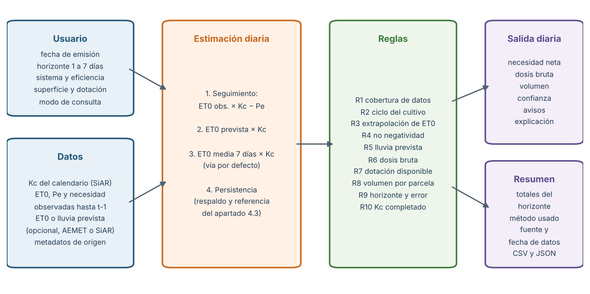

# 5.1. Diseño del sistema de recomendación de riego

El capítulo anterior dejó dos resultados que condicionan el diseño del sistema.
Por un lado, la necesidad neta publicada por SiAR puede reconstruirse a partir
de la ET0, el coeficiente de cultivo y la precipitación efectiva, de modo que
existe una referencia agronómica explicable para los días ya cerrados. Por
otro, ninguno de los cinco algoritmos de aprendizaje automático evaluados en el
apartado 4.3 superó de forma estable a la persistencia cuando se trata de
anticipar el día siguiente. El motor de recomendación se ha construido a partir
de ambas constataciones. Su función consiste en transformar la información
disponible en una dosis de riego diaria y en un total para el horizonte
solicitado, dejando constancia del origen de cada cifra y de las situaciones en
las que la propuesta merece menos confianza.

El sistema se mantiene dentro del alcance definido en el apartado 1.3. No
acciona válvulas ni programadores y no pretende sustituir el criterio del
técnico o del agricultor. Tampoco estima el riego óptimo medido en parcela,
porque no se dispone de humedad del suelo, riego aplicado ni respuesta
productiva. Lo que ofrece es una referencia hídrica razonada, acompañada de las
reglas que la han modificado y de las advertencias que deben revisarse antes de
regar, en línea con el planteamiento híbrido descrito en el apartado 2.3
(Navarro-Hellín et al., 2016; Zhai et al., 2020).

## 5.1.1. Requisitos de partida

Los requisitos se derivaron de los objetivos del capítulo 1 y de las
limitaciones detectadas durante el procesamiento de los datos. El usuario debe
poder indicar la fecha en la que solicita la recomendación, el número de días
que desea planificar, el sistema de riego o su eficiencia, la superficie de la
parcela y, si existe, una dotación semanal máxima. Con esos parámetros el
sistema tiene que devolver, para cada día, la necesidad neta en milímetros, la
dosis bruta ajustada por eficiencia, el volumen cuando se conoce la superficie,
un nivel de confianza, las advertencias pertinentes y una explicación en
lenguaje llano.

A estos requisitos funcionales se añadieron tres condiciones de diseño. La
primera es temporal: una recomendación emitida en una fecha solo puede utilizar
información disponible antes de esa fecha, igual que se exigió a los modelos del
capítulo 4. La segunda es de trazabilidad: cada resultado debe poder
relacionarse con el método que lo produjo, las reglas aplicadas, el archivo de
origen y el último dato observado. La tercera es de prudencia: ante datos
ausentes, desactualizados o fuera del intervalo conocido, el sistema debe
avisar o abstenerse antes que ofrecer una cifra aparentemente precisa. La
literatura sobre adopción de herramientas agrícolas insiste en que la confianza
del usuario depende de que entienda por qué se le propone una actuación (Rose
et al., 2016), y por esa razón la explicación forma parte de la salida y no de
la documentación.

## 5.1.2. Arquitectura del motor

La Figura 5.1 resume el recorrido de una consulta. Las entradas del usuario y
los datos de la fuente alimentan un módulo de estimación diaria; su resultado
pasa por un conjunto de reglas numeradas y, finalmente, se genera una salida
diaria y un resumen del horizonte. La lógica se encuentra en `src/dss`, separada
de los clientes de las APIs y de los módulos de modelado, de forma que puede
reutilizarse desde la línea de comandos, desde la interfaz del apartado 5.2 o
desde los scripts de validación del apartado 5.3.

El caso analizado se describe mediante un objeto de configuración que reúne
cultivo, sistema productivo, estación y archivo de origen. Para el piloto, ese
objeto apunta al CSV oficial de necesidades de pimiento de la estación AL01 La
Mojonera. Cambiar de cultivo o de estación consiste en declarar un caso nuevo
con su propio archivo, sin modificar el motor. Al cargar la fuente, el sistema
reconstruye el calendario diario completo: las tres fechas que SiAR no devolvió
en julio se conservan como filas sin dato y no se interpretan como necesidad
nula. Como el coeficiente de cultivo procede del calendario del cultivo y se
conoce de antemano, en esas fechas se toma el último valor publicado y se marca
la imputación.

## 5.1.3. Estimación de la necesidad neta

El motor distingue dos modos de consulta. En el modo de seguimiento se
analizan días ya cerrados y se aplica la expresión agronómica con las
variables observadas:

necesidad neta = max(ET0 × Kc − Pe, 0)

Este modo sirve para revisar a posteriori lo que debería haberse aplicado y
para comparar la planificación con la referencia. En el modo de planificación,
que es el uso operativo, la ET0 y la precipitación efectiva del día que se
quiere regar todavía no se conocen. Para ese caso se establecieron tres vías
con un orden de preferencia fijo.

La vía preferente utiliza una ET0 prevista cuando el usuario o la fuente la
proporcionan, ya sea el producto pronosticado de SiAR o una estimación
calculada a partir de la predicción de AEMET. La necesidad se obtiene
multiplicando esa ET0 por el Kc del día. La segunda vía, que es la que se
emplea por defecto en el piloto porque no se dispone de un histórico de
predicciones alineado con la campaña, sustituye la ET0 futura por la media de
la ET0 observada en los siete días anteriores y la combina con el Kc del día
objetivo. La tercera vía es la persistencia del apartado 4.3: se repite la
última necesidad neta conocida. Solo se recurre a ella cuando no hay ninguna
ET0 reciente, y en todos los casos su valor se guarda junto a la recomendación
como referencia de comparación.

La segunda vía merece una justificación, porque no figuraba entre los enfoques
comparados en el capítulo 4. La necesidad neta del piloto depende casi por
completo de dos factores, la demanda evaporativa y el coeficiente de cultivo.
El primero cambia de forma gradual entre días consecutivos; el segundo cambia
de golpe al pasar de una fase a otra y, sin embargo, se conoce con antelación.
La persistencia trata ambos factores como si fueran igual de inerciales y, por
eso, arrastra durante días el valor de la fase anterior cuando el Kc salta de
0,70 a 0,90 el 1 de julio o de 1,00 a 0,30 el 1 de septiembre. Separar los dos
componentes permite aprovechar la continuidad de la ET0 sin renunciar a lo que
ya se sabe del calendario. La elección de la ventana de siete días y la
comparación con la persistencia en cada horizonte se presentan en el apartado
5.3; aquí basta señalar que la ventana se fijó con el periodo de desarrollo y
que el tramo de prueba reservado en el capítulo 4 no intervino en esa decisión.

La lluvia prevista no se descuenta de forma automática. La precipitación
efectiva depende de la intensidad, del estado del suelo y de las pérdidas por
escorrentía o percolación, y solo puede valorarse con cierta fiabilidad una vez
ha llovido (Allen et al., 1998). En un clima como el de la costa de Almería,
donde la precipitación efectiva acumulada de toda la campaña fue de 2,51 mm,
restar una lluvia pronosticada que finalmente no llega supondría dejar el
cultivo sin agua en pleno verano. El sistema opta por mantener la dosis y
avisar de que conviene aplazar el riego y recalcular cuando se conozca la
precipitación real.

## 5.1.4. Reglas de decisión

Sobre la estimación se aplica un conjunto de diez reglas, numeradas para que
aparezcan en la salida con la misma denominación que en esta memoria. La Tabla
5.1 recoge su finalidad y su efecto.

**Tabla 5.1. Reglas aplicadas por el motor de recomendación.**

| Regla | Finalidad | Efecto sobre la recomendación |
|---|---|---|
| R1 Cobertura de datos | Comprobar que existen observaciones recientes suficientes | Cambia de vía de estimación y añade un aviso cuando faltan datos |
| R2 Ciclo del cultivo | Evitar recomendaciones fuera del calendario publicado | No se emite recomendación |
| R3 Extrapolación | Detectar una ET0 alejada más de un 10 % del intervalo observado | Aviso de extrapolación y confianza baja |
| R4 No negatividad | Impedir dosis negativas cuando la lluvia supera la ETc | La necesidad se fija en 0 mm |
| R5 Lluvia prevista | Señalar episodios de lluvia de al menos 5 mm o probabilidad del 60 % | Aviso de aplazamiento sin descontar la lluvia |
| R6 Dosis bruta | Incorporar las pérdidas del sistema de aplicación | Dosis bruta = necesidad neta / eficiencia |
| R7 Dotación disponible | Respetar un límite semanal de agua | Reducción proporcional y aviso de déficit |
| R8 Volumen | Expresar la dosis por parcela | 1 mm sobre 1 ha equivale a 10 m3 |
| R9 Horizonte | Informar de que el error crece con la anticipación | Se indica el error medio esperado para ese día |
| R10 Kc completado | Dejar constancia de fechas no devueltas por la fuente | Aviso de imputación del Kc |

La regla R6 incorpora la diferencia entre lo que necesita el cultivo y lo que
hay que aplicar. Las eficiencias por defecto son las orientativas de la FAO
para riego de superficie, aspersión y goteo, del 60 %, 75 % y 90 %
respectivamente (Brouwer et al., 1989). El usuario puede sustituirlas por la
eficiencia medida en su instalación, que es preferible porque la eficiencia
real depende del diseño, del mantenimiento y de la uniformidad de cada sistema
(Burt et al., 1997). El valor admitido se limita al intervalo entre 0,30 y
1,00 para evitar errores de introducción.

La regla R7 es la forma en la que el prototipo incorpora una restricción de
disponibilidad hídrica. El anteproyecto contemplaba utilizar el Boletín
Hidrológico del MITECO, pero sus datos se publican a escala de embalse y de
cuenca, con frecuencia semanal y carácter provisional (MITECO, s. f.), lo que no
permite deducir de forma directa cuánta agua corresponde a una parcela. Se ha
preferido que la restricción la introduzca el usuario como dotación semanal,
que es el dato que realmente recibe de su comunidad de regantes. Cuando la
dosis planificada supera esa dotación, el sistema la reduce de forma
proporcional y lo indica. Esta reducción es una simplificación consciente: el
riego deficitario bien diseñado concentra el déficit en las fases menos
sensibles del cultivo (Fereres & Soriano, 2007), y por eso el aviso invita a
revisar qué días conviene recortar en lugar de presentar el reparto como
óptimo.

Las reglas R1, R2, R3 y R9 traducen a la práctica la exigencia, recogida en el
apartado 2.3, de que la incertidumbre forme parte de la salida. A partir de
ellas se asigna a cada día un nivel de confianza. Es alta cuando se trata de un
día cerrado calculado con datos observados; media en los tres primeros días de
una planificación sin incidencias; y baja a partir del cuarto día o cuando
existe cualquier aviso, incluido el de datos con más de dos días de
antigüedad. Los umbrales de horizonte se apoyan en los errores medidos en el
apartado 5.3 y pueden ajustarse cuando se disponga de más campañas.

## 5.1.5. Estructura de la salida

Cada consulta genera una tabla diaria con dieciocho campos y un resumen del
horizonte. La tabla incluye la fecha, el día del horizonte, el Kc, la ET0
utilizada y su origen, la necesidad neta, el método, la persistencia como
referencia, la dosis bruta, el factor de dotación, el volumen, la confianza,
las reglas aplicadas, los avisos, la explicación, la fecha del último dato
observado y el archivo de origen. El resumen agrega los totales, el método
principal, la eficiencia aplicada y el número de días con avisos. La cabecera
conserva la versión del motor, los parámetros de la consulta, la URL de la
fuente y la fecha de descarga. Todo ello se exporta en CSV y JSON, lo que
permite archivar las recomendaciones emitidas y compararlas más adelante con
lo que realmente se regó.

La explicación se redacta a partir de los mismos valores que aparecen en la
tabla. Para el 1 de julio de 2025, por ejemplo, la salida indica que la
necesidad neta estimada es de 6,2 mm a partir de una ET0 media reciente de 6,84
mm y un Kc de 0,90, y que con una eficiencia del 90 % la dosis bruta propuesta
es de 6,8 mm, unos 103 m3 para una parcela de 1,5 ha. La frase no añade
información que no esté en los datos, pero permite que el usuario compruebe el
razonamiento sin interpretar una tabla de dieciocho columnas.

## 5.1.6. Decisiones descartadas

Durante el diseño se valoraron otras alternativas que finalmente no se
incorporaron. La primera fue utilizar como motor el modelo Ridge, segundo
clasificado en el apartado 4.3. Se descartó porque no superó de forma estable a
la persistencia y porque su comportamiento ante un cambio de fase del cultivo
resulta menos transparente que una multiplicación por el Kc. La segunda fue
estimar la ET0 futura con la ecuación de Hargreaves a partir de las
temperaturas previstas por AEMET. Es una opción contemplada en FAO-56 para
cuando faltan variables (Allen et al., 1998), pero no se dispone de un
histórico de predicciones de la campaña de 2025 con el que calibrarla, y
presentar una vía no evaluada como parte del sistema habría contradicho el
criterio seguido en el resto del trabajo. El motor admite una ET0 prevista como
entrada para que esa vía pueda incorporarse cuando exista la evidencia. La
tercera alternativa fue un balance hídrico del suelo con agotamiento admisible,
que permitiría decidir no solo cuánto sino cuándo regar. Requiere capacidad de
retención, profundidad radicular y riegos previos de la parcela, datos que el
piloto no tiene, y se plantea como evolución en el capítulo 6.
