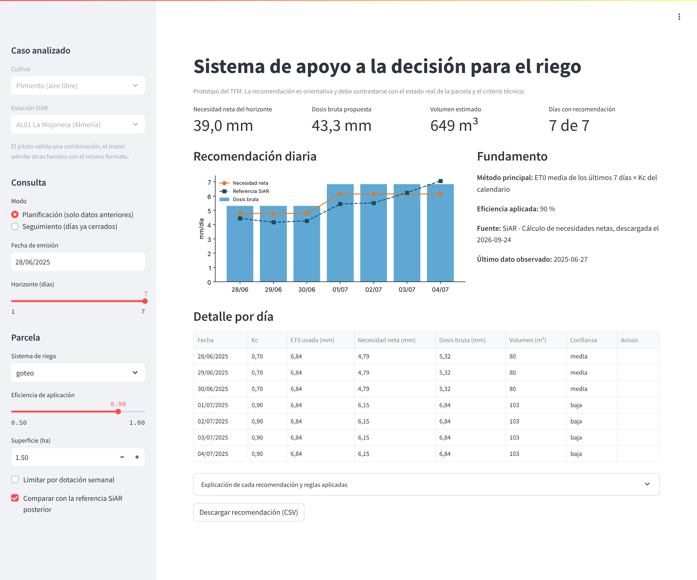

# 5.2. Aplicación y visualización de resultados

El motor descrito en el apartado anterior solo resulta útil si una persona
puede consultarlo sin abrir el código. Para ello se han preparado dos formas de
acceso que comparten exactamente la misma lógica: una ejecución por línea de
comandos, pensada para automatizar consultas y archivar resultados, y una
aplicación web ligera, pensada para la demostración y para el usuario que
quiere explorar escenarios. Ninguna de las dos realiza cálculos propios; ambas
llaman a la función de recomendación de `src/dss/engine.py`, de modo que lo que
se ve en pantalla coincide con lo que se valida en el apartado 5.3.

## 5.2.1. Elección de la tecnología de presentación

El anteproyecto contemplaba un cuadro de mando en Power BI o Tableau. Se
mantuvo esa opción hasta disponer de un motor funcional, y en ese momento se
comprobó que la herramienta debía cumplir dos condiciones que un cuadro de
mando convencional resuelve con dificultad. La primera es interactiva: cambiar
la fecha de emisión, el horizonte o la eficiencia tiene que volver a ejecutar
el motor, no solo filtrar una tabla ya calculada. La segunda es de
reproducibilidad: cualquier miembro del tribunal o del equipo debería poder
lanzar la aplicación desde el repositorio con las mismas dependencias que el
resto del proyecto.

Por esas razones se optó por Streamlit, una librería de Python que construye
la interfaz a partir de un único script y vuelve a ejecutarlo cada vez que el
usuario modifica un control (Streamlit, 2024). La aplicación se encuentra en
`src/dss/app_streamlit.py` y se arranca desde la raíz del repositorio con
`streamlit run src/dss/app_streamlit.py`. Power BI y Tableau quedan como
alternativa para un uso agregado, por ejemplo para una cooperativa que quiera
comparar parcelas a partir de las recomendaciones archivadas en CSV, pero no
se presentan como implementados porque no existe un archivo funcional en el
repositorio que lo demuestre.

## 5.2.2. Organización de la interfaz

La pantalla se divide en un panel lateral de entrada y un área principal de
resultados. El panel lateral agrupa los controles en tres bloques. En el
primero se muestran el cultivo y la estación del caso analizado; están
bloqueados porque el piloto valida una sola combinación, aunque el texto
recuerda que el motor admite otras fuentes con el mismo formato. El segundo
bloque recoge la consulta: el modo de planificación o seguimiento, la fecha de
emisión y el horizonte de uno a siete días. El tercero describe la parcela: el
sistema de riego, la eficiencia, que se rellena con el valor orientativo del
sistema pero puede modificarse, la superficie y, de manera opcional, una
dotación semanal. Una casilla final permite superponer la referencia SiAR
calculada a posteriori, algo que solo tiene sentido en una demostración
retrospectiva como la de este trabajo.

El área principal sigue el orden en el que un técnico suele leer una
recomendación. Arriba aparecen cuatro indicadores: la necesidad neta del
horizonte, la dosis bruta propuesta, el volumen estimado y el número de días
con recomendación. Debajo se sitúa un gráfico de barras con la dosis bruta de
cada día y la necesidad neta superpuesta, acompañado de un bloque titulado
Fundamento que indica el método principal, la eficiencia aplicada, la fuente
con su fecha de descarga y el último dato observado. Si existe algún aviso
general, como datos desactualizados o una dotación insuficiente, se muestra en
un recuadro destacado encima de los indicadores. La parte inferior contiene la
tabla diaria con la confianza y los avisos, un desplegable con la explicación y
las reglas aplicadas a cada día, y un botón para descargar la recomendación en
CSV.

Las cifras de resultados se presentan con coma decimal y las fechas en formato día, mes y
año. Puede parecer un detalle menor, pero la aplicación está dirigida a
usuarios españoles y una tabla con puntos decimales obliga a una lectura más
lenta y propicia errores al trasladar los valores a un programador de riego.

## 5.2.3. Ejemplo de uso en un cambio de fase del cultivo

Para ilustrar el funcionamiento se ha elegido una situación exigente: una
planificación emitida el 28 de junio de 2025 con un horizonte de siete días,
que atraviesa el paso del Kc de 0,70 a 0,90 el 1 de julio. Se considera riego
por goteo con eficiencia del 90 % y una parcela de 1,5 ha. La Figura 5.2
reproduce la pantalla obtenida con la referencia SiAR superpuesta.



Con la información disponible hasta el 27 de junio, la ET0 media de los siete
días anteriores es de 6,84 mm. Multiplicada por el Kc de cada día, da lugar a
una necesidad neta de 4,79 mm para los tres últimos días de junio y de 6,15 mm
a partir del 1 de julio. La Tabla 5.2 compara esa planificación con la
referencia que SiAR publicó después y con lo que habría propuesto la
persistencia.

**Tabla 5.2. Planificación emitida el 28 de junio de 2025 frente a la referencia SiAR.**

| Fecha | Kc | Necesidad DSS (mm) | Persistencia (mm) | Referencia SiAR (mm) | Dosis bruta (mm) | Volumen (m3) | Confianza |
|---|---:|---:|---:|---:|---:|---:|---|
| 28/06/2025 | 0,70 | 4,79 | 4,34 | 4,44 | 5,32 | 80 | media |
| 29/06/2025 | 0,70 | 4,79 | 4,34 | 4,17 | 5,32 | 80 | media |
| 30/06/2025 | 0,70 | 4,79 | 4,34 | 4,26 | 5,32 | 80 | media |
| 01/07/2025 | 0,90 | 6,15 | 4,34 | 5,45 | 6,84 | 103 | baja |
| 02/07/2025 | 0,90 | 6,15 | 4,34 | 5,52 | 6,84 | 103 | baja |
| 03/07/2025 | 0,90 | 6,15 | 4,34 | 6,24 | 6,84 | 103 | baja |
| 04/07/2025 | 0,90 | 6,15 | 4,34 | 7,07 | 6,84 | 103 | baja |
| **Total** | | **38,96** | **30,38** | **37,15** | **43,29** | **649** | |

En el conjunto de la semana, el sistema planifica 38,96 mm netos frente a los
37,15 mm de la referencia, una diferencia de 1,81 mm o del 4,9 %. La
persistencia habría propuesto 30,38 mm, es decir, 6,77 mm menos de lo que
finalmente necesitó el cultivo, porque mantiene durante toda la semana el
valor de junio. El ejemplo muestra el motivo por el que se separaron la ET0 y
el Kc en el diseño: la subida de la demanda al cambiar de fase se anticipa
desde el primer día, aunque la ET0 se suponga constante.

El ejemplo también deja ver las limitaciones. Los días 28 a 30 de junio el
sistema sobrestima, porque la semana anterior tuvo una demanda evaporativa mayor que la
siguiente, y el 3 y el 4 de julio infraestima por la razón contraria. Una
media de siete días no puede anticipar un cambio de tiempo; para ello haría
falta una ET0 prevista. La interfaz lo refleja asignando confianza media a los
tres primeros días y baja a los cuatro siguientes, e indicando en las reglas el
error medio esperado para cada día del horizonte.

## 5.2.4. Uso desde la línea de comandos

La misma consulta puede lanzarse sin interfaz, lo que resulta útil para
programar una recomendación diaria o para integrarla en otro sistema:

```powershell
python -m src.dss.recommend --fecha 2025-06-28 --horizonte 7 --superficie 1.5
```

El comando escribe en la consola la explicación de cada día y los totales, y
guarda la tabla diaria y el resumen en `results/reports` en formato CSV y JSON.
Los argumentos opcionales permiten indicar otro sistema de riego, una
eficiencia propia, una dotación semanal, el modo de seguimiento o un archivo
con ET0 o lluvia prevista. El ejemplo de la Tabla 5.2 se conserva también como
muestra versionada en `docs/data_samples/dss_recommendation_example_5_2.csv`.

## 5.2.5. Visualización de la campaña

Además de la consulta puntual, se han generado dos figuras que resumen el
comportamiento del sistema a lo largo de toda la campaña y que se analizan en
el apartado 5.3. La primera simula que el agricultor consulta el sistema cada
mañana con la información del día anterior y compara cada recomendación con la
referencia SiAR. La segunda agrega los resultados por semanas naturales, que es
la escala en la que suelen planificarse los turnos de riego y las dotaciones.
Ambas se generan con el mismo código que valida el sistema, de manera que
cualquier cambio en el motor se refleja automáticamente en las figuras de la
memoria.

## 5.2.6. Limitaciones de la aplicación

La aplicación es un prototipo de demostración. No dispone de usuarios ni de
control de acceso, no guarda un histórico de consultas por parcela y lee la
fuente desde un archivo local en lugar de una base de datos. Tampoco descarga
por sí misma la predicción de AEMET; la vía de ET0 prevista está implementada en
el motor y se ha probado con datos de ejemplo, pero la interfaz trabaja con la
vía por defecto. Estas carencias no impiden demostrar el funcionamiento del
sistema, aunque sí condicionan su uso real. Por último, la interfaz no se ha
evaluado con agricultores ni técnicos. La literatura señala que la facilidad de
uso y la relevancia percibida son determinantes para que una herramienta de
este tipo se adopte (Rose et al., 2016), por lo que esa evaluación con usuarios
se considera un paso necesario antes de cualquier despliegue.
