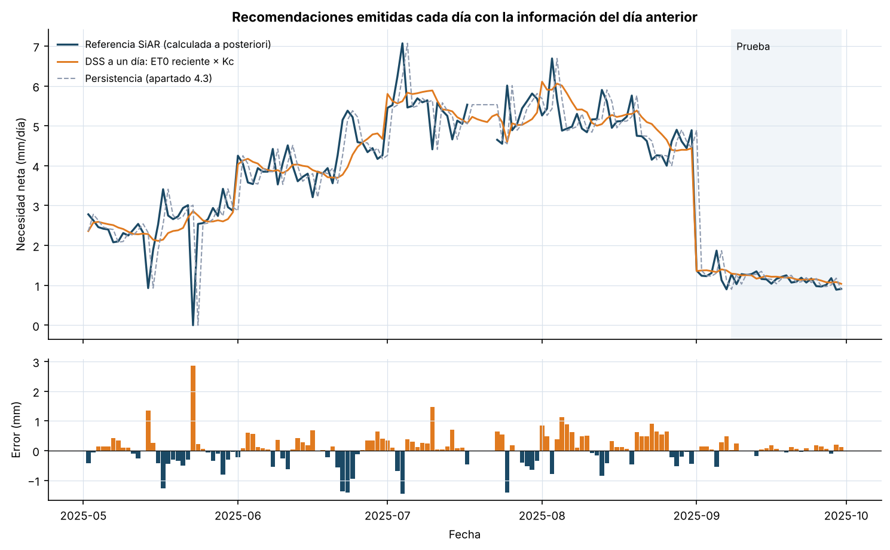
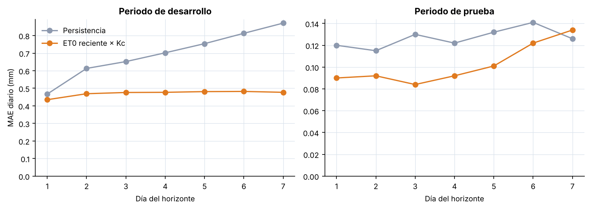
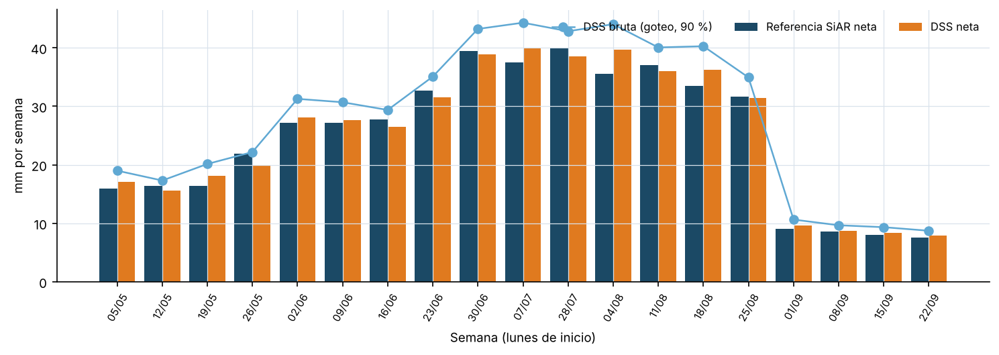

# 5.3. Validación, resultados y análisis crítico

La validación del sistema no puede limitarse a repetir las métricas del
capítulo 4. Allí se evaluaba si un modelo anticipaba bien una variable; aquí
interesa saber si el conjunto formado por la estimación, las reglas y la salida
produce recomendaciones correctas, coherentes y seguras en las condiciones en
las que se utilizaría. Siguiendo las dimensiones planteadas en el apartado 2.3,
la evaluación se ha organizado en cuatro niveles: la fidelidad de la vía
agronómica, el error de la planificación frente a la referencia, el
comportamiento ante situaciones anómalas y el rendimiento operativo. Todas las
cifras proceden de `src/analysis/build_validation_5_3.py`, que las regenera a
partir del CSV oficial del piloto.

Conviene precisar desde el principio qué significa validar en este contexto.
La referencia utilizada es la necesidad neta calculada por SiAR, no el riego
aplicado por un agricultor ni la respuesta del cultivo. Tampoco se ha contado
con técnicos o regantes que revisaran las recomendaciones. Lo que se presenta
es, por tanto, una validación técnica del prototipo con escenarios
documentados. Demostrar un ahorro de agua o una mejora productiva exigiría un
ensayo de campo con un diseño distinto, algo que queda fuera del alcance
declarado en el apartado 1.3.

## 5.3.1. Fidelidad de la vía agronómica

El primer control consistió en comprobar que el modo de seguimiento reproduce
la referencia publicada. En los 148 días con ET0 observada, la diferencia
máxima entre la necesidad calculada por el motor y la publicada por SiAR fue de
0,008 mm, atribuible al redondeo a dos decimales de la fuente. Este resultado
confirma que el sistema interpreta correctamente las columnas del CSV y que la
expresión agronómica es la misma que utiliza SiAR.

La comprobación reveló además un matiz del total oficial. El metadato de la
descarga indica una necesidad neta de 530,47 mm para la campaña, mientras que
la suma de las necesidades diarias es de 531,05 mm. La diferencia procede del
23 de mayo, el único día en que la lluvia efectiva (2,34 mm) superó a la ETc
(1,75 mm). SiAR obtiene el total como suma de la ETc menos suma de la lluvia
efectiva y deja que ese excedente de 0,58 mm compense necesidades de otros
días; el motor, en cambio, fija la necesidad de ese día en cero y no traslada
el excedente. Para un sistema que no modela el almacenamiento del suelo, el
segundo criterio es el más prudente, pero la discrepancia se documenta para que
nadie la confunda con un error de cálculo.

## 5.3.2. Selección de la ventana de ET0

La vía por defecto del sistema promedia la ET0 de los días anteriores. Antes de
fijar la longitud de esa ventana se evaluaron cinco alternativas, de uno a
catorce días, simulando emisiones diarias con horizontes de uno a siete días.
Para mantener la coherencia con el capítulo 4, se utilizó como prueba el mismo
tramo reservado, del 8 al 30 de septiembre, y la selección se hizo únicamente
con el periodo de desarrollo. Como criterio se fijó, antes de calcular los
resultados, elegir la ventana más corta cuyo error no superase al mínimo en más
de un 1 %, porque una ventana corta reacciona antes ante un cambio de tiempo.

**Tabla 5.3. MAE medio de los horizontes 1 a 7 según la ventana de ET0 (mm/día).**

| Ventana | Desarrollo | Prueba |
|---:|---:|---:|
| 1 día | 0,517 | 0,127 |
| 3 días | 0,494 | 0,110 |
| 5 días | 0,484 | 0,101 |
| 7 días | **0,471** | **0,101** |
| 14 días | 0,469 | 0,124 |

Las ventanas de siete y catorce días son prácticamente equivalentes en
desarrollo, con una diferencia de 0,002 mm, y el criterio selecciona la de
siete. En la prueba esa elección resulta favorable, aunque no se utilizó para
decidir. La tabla muestra también que las ventanas de uno y tres días son
claramente peores: la ET0 de un día aislado incorpora demasiado ruido para
representar la demanda de los días siguientes.

## 5.3.3. Error de la recomendación a un día

El uso principal del sistema es la consulta diaria con la información del día
anterior. Para evaluarlo se simuló una campaña completa en la que el sistema
emite una recomendación cada mañana, del 2 de mayo al 30 de septiembre, y se
comparó cada una con la referencia SiAR del mismo día. Se emitieron 152
recomendaciones, de las cuales 147 pudieron contrastarse; las cinco restantes
corresponden a fechas sin referencia publicada.

**Tabla 5.4. Error de la recomendación a un día frente a la referencia SiAR.**

| Periodo | Enfoque | Días | MAE (mm) | RMSE (mm) | Sesgo (mm) |
|---|---|---:|---:|---:|---:|
| Desarrollo | DSS (ET0 reciente × Kc) | 124 | **0,417** | **0,583** | 0,044 |
| Desarrollo | Persistencia | 124 | 0,449 | 0,710 | 0,012 |
| Prueba | DSS (ET0 reciente × Kc) | 23 | **0,090** | **0,113** | 0,047 |
| Prueba | Persistencia | 23 | 0,120 | 0,156 | 0,000 |

El sistema reduce el MAE respecto a la persistencia en un 7 % en desarrollo y
en un 25 % en la prueba. La reducción es mayor en el RMSE, un 18 % en
desarrollo, lo que indica que la mejora se concentra en los errores grandes. La
Figura 5.3 ayuda a entenderlo. Los mayores errores de la persistencia se
producen el primer día de cada fase, cuando repite el valor de la fase
anterior; el 1 de septiembre, con el paso del Kc de 1,00 a 0,30, se desvía 3,52
mm, mientras que el sistema lo hace en 0,01 mm. El otro episodio destacado es
la lluvia del 23 de mayo, que ninguna de las dos vías puede anticipar sin una
predicción de precipitación y que la persistencia arrastra además al día
siguiente. El MAE de la persistencia en la prueba, 0,120 mm,
coincide con el obtenido en el apartado 4.3, lo que confirma que ambos
experimentos parten de la misma referencia. En desarrollo los valores no son
directamente comparables con los de la Tabla 4.10, porque aquí se evalúan todas
las emisiones del periodo y no tres cortes de validación.



El sesgo del sistema es ligeramente positivo, de 0,04 a 0,05 mm al día. Tiende
por tanto a recomendar algo más de agua que la referencia, sobre todo en
septiembre, cuando la ET0 desciende de forma sostenida y la media de los siete
días anteriores queda siempre por encima del valor del día. En una herramienta
de apoyo al riego un sesgo pequeño y positivo es preferible a uno negativo,
porque el déficit hídrico tiene consecuencias más difíciles de revertir que un
ligero exceso. Aun así, a lo largo de la campaña ese sesgo se traduce en 535,2
mm recomendados frente a 528,7 mm de referencia en los mismos días, un 1,2 %
más, y esta cifra debe tenerse presente si el sistema se utiliza para
planificar volúmenes.

Los valores absolutos del MAE no deben compararse sin más entre periodos,
porque la necesidad de septiembre es cinco veces menor que la de agosto. En
términos relativos, el error acumulado equivale al 10,3 % de la necesidad de
referencia en desarrollo y al 8,0 % en la prueba, una diferencia mucho menor
de lo que sugieren los 0,417 y 0,090 mm de la Tabla 5.4. El MAE se ha mantenido como métrica principal por su interpretación directa en
milímetros y su menor sensibilidad a valores extremos (Willmott & Matsuura,
2005), y se acompaña del RMSE precisamente para no ocultar los errores grandes.

## 5.3.4. Error según el horizonte de planificación

Cuando el usuario planifica varios días, el sistema no recibe observaciones
nuevas y el error crece con la anticipación. La Figura 5.4 y la Tabla 5.5
comparan la vía del sistema con una persistencia extendida, que repite la
última necesidad conocida durante todo el horizonte y es el punto de partida
habitual en predicción de series temporales (Hyndman & Athanasopoulos, 2021).



**Tabla 5.5. MAE diario según el día del horizonte (mm/día).**

| Día del horizonte | Persistencia, desarrollo | DSS, desarrollo | Persistencia, prueba | DSS, prueba |
|---:|---:|---:|---:|---:|
| 1 | 0,467 | 0,435 | 0,120 | 0,090 |
| 2 | 0,613 | 0,469 | 0,115 | 0,092 |
| 3 | 0,652 | 0,476 | 0,130 | 0,084 |
| 4 | 0,702 | 0,477 | 0,122 | 0,092 |
| 5 | 0,754 | 0,481 | 0,132 | 0,101 |
| 6 | 0,813 | 0,482 | 0,141 | 0,122 |
| 7 | 0,871 | 0,477 | 0,126 | 0,134 |

En el periodo de desarrollo el error de la persistencia casi se duplica entre
el primer y el séptimo día, mientras que el del sistema se mantiene entre 0,44 y
0,48 mm. Al separar los casos se aprecian dos causas. Cuando el horizonte cruza
un cambio de fase, lo que ocurre en el 4 % de las emisiones a un día y en el
25 % a siete días, la persistencia comete un error medio de unos 1,6 mm y el
sistema de 0,33 a 0,43 mm. Cuando no lo cruza, la persistencia pasa de 0,42 a
0,63 mm entre el primer y el séptimo día y el sistema de 0,44 a 0,51 mm, porque
la media de siete días filtra las oscilaciones de un día concreto y representa
mejor el nivel de demanda de los días siguientes. En ese último subconjunto la
persistencia es ligeramente mejor a un día, con 0,42 frente a 0,44 mm, de modo
que la ventaja del sistema en el primer día procede sobre todo de los cambios
de fase. En la prueba el
comportamiento es distinto. Septiembre tiene un Kc constante y una ET0 en
descenso continuo, de modo que ninguna de las dos vías dispone de información
sobre esa tendencia. El sistema mantiene la ventaja hasta el quinto día, la
reduce en el sexto y pierde frente a la persistencia en el séptimo, con 0,134
frente a 0,126 mm.

Estos resultados justifican tres decisiones del diseño. La primera es ofrecer
horizontes de hasta siete días, puesto que el error se mantiene acotado y
nunca empeora de manera brusca. La segunda es asignar confianza baja a partir
del cuarto día, porque es a partir de ahí cuando el comportamiento empieza a
depender de la evolución del tiempo. La tercera es mostrar en cada día el error
esperado de la tabla anterior mediante la regla R9, en lugar de presentar una
semana entera con la misma apariencia de certeza. Una mejora real en los
horizontes largos requiere una ET0 prevista, cuya vía ya está preparada en el
motor.

## 5.3.5. Coherencia semanal

Muchas decisiones de riego, como los turnos de una comunidad o la solicitud de
agua, se toman a escala semanal. Se agregaron por ello las recomendaciones
diarias en semanas naturales de lunes a domingo y se compararon con la
referencia. Se consideraron solo las diecinueve semanas completas; las dos
semanas de julio afectadas por fechas sin datos se excluyeron para no
comparar totales con un número distinto de días.



El error absoluto medio semanal es de 1,21 mm, con un máximo de 4,10 mm, lo
que equivale a un 4,8 % de la necesidad total de esas semanas. Las mayores
diferencias aparecen en las semanas que comienzan el 7 de julio y el 4 y el 18
de agosto, con 2,32, 4,10 y 2,73 mm, cuando la necesidad semanal se sitúa entre
33 y 40 mm y la ET0 cambia de forma apreciable de una semana a otra. La Figura 5.5 permite comprobar también que la dosis
bruta mantiene siempre la proporción fijada por la eficiencia y que la caída de
septiembre se refleja desde la primera semana del mes.

Además de la exactitud, se verificó la coherencia interna. En todas las
consultas comprobadas la suma de las dosis diarias coincide con el total del
resumen y el volumen coincide con diez metros cúbicos por milímetro y
hectárea. A lo largo de la campaña no se generó ninguna dosis negativa.

## 5.3.6. Sensibilidad a la eficiencia del riego

La eficiencia es el parámetro que más modifica la cantidad de agua propuesta,
y es también el más difícil de conocer con precisión. Aplicada sobre la
necesidad neta de toda la campaña, la diferencia entre sistemas resulta
considerable.

**Tabla 5.6. Dosis bruta de la campaña según el sistema de riego.**

| Sistema | Eficiencia | Dosis bruta (mm) | Volumen (m3/ha) |
|---|---:|---:|---:|
| Goteo | 0,90 | 590,1 | 5.901 |
| Aspersión | 0,75 | 708,1 | 7.081 |
| Superficie | 0,60 | 885,1 | 8.851 |

Con la misma necesidad del cultivo, pasar del riego por goteo al de superficie
supone aplicar un 50 % más de agua. Una desviación de diez puntos en la
eficiencia introducida, por ejemplo usar 0,90 cuando la instalación real
trabaja a 0,80, genera un error de alrededor del 12 % en la dosis bruta,
bastante mayor que el error de estimación de la necesidad neta medido en los
apartados anteriores. Esta comparación sitúa las prioridades de mejora: en una
explotación real, medir la eficiencia y la uniformidad de la instalación
aportaría más precisión que refinar el modelo de ET0 (Burt et al., 1997).
También recuerda que una dosis menor no equivale a un ahorro neto de agua a
escala de cuenca, porque parte de las pérdidas en parcela retorna al sistema
hidrológico (Perry, 2007).

## 5.3.7. Escenarios de robustez y trazabilidad

El último bloque de la validación sometió al sistema a situaciones en las que
una recomendación incorrecta podría causar daños o confusión. Se definieron
trece escenarios con un comportamiento esperado fijado de antemano; los
resultados se guardan en `docs/data_samples/dss_scenarios_5_3.csv` y se
resumen en la Tabla 5.7.

**Tabla 5.7. Escenarios de validación del comportamiento del sistema.**

| Escenario | Comportamiento esperado | Resultado observado |
|---|---|---|
| Lluvia observada superior a la ETc (23/05) | Dosis nula, nunca negativa | Necesidad de 0,00 mm por la regla R4 |
| Lluvia prevista de 12 mm con probabilidad del 80 % | Aviso sin descuento automático | Se recomienda aplazar y la dosis no cambia |
| Cinco fechas sin meteorología (18 a 22/07) | Sustitución explícita y aviso | Se usa la ET0 reciente, con aviso en cada día |
| Emisión el 21/07 con el último dato del 17/07 | Aviso general y confianza baja | Aviso de antigüedad y confianza baja en todo el horizonte |
| ET0 prevista de 11,5 mm | Aviso de extrapolación | Se marca como extrapolación |
| Fechas posteriores al ciclo (1 y 2/10) | Sin recomendación | No se emite dosis |
| Primer día de campaña sin histórico | Sin recomendación | No se emite dosis |
| Eficiencia 1,4, horizonte de 10 días, superficie negativa, sistema desconocido | Rechazo con mensaje | Las cuatro entradas se rechazan |
| Dotación de 20 mm frente a 47,1 mm planificados | Reducción proporcional y aviso | Factor de 0,42 y total de 20 mm |
| Eficiencias de 0,60 a 1,00 | Dosis decreciente con la eficiencia | 70,7, 56,6, 47,1 y 42,4 mm semanales |
| Coherencia entre día, semana y volumen | Sumas consistentes | Coinciden dosis y volumen |
| Trazabilidad de cada fila | Origen y reglas registrados | Método, reglas, archivo y fecha presentes |
| Cambio de Kc de 0,70 a 0,90 (01/07) | El calendario corrige la persistencia | Error de 0,35 mm frente a 1,19 mm |

Los trece escenarios produjeron el comportamiento esperado. Más que el
recuento, interesa lo que estos casos revelan sobre el diseño. En ninguno de
ellos el sistema sustituye una ausencia por un cero ni oculta que ha cambiado
de vía de estimación, y en los casos sin información suficiente prefiere no
emitir recomendación. Este comportamiento responde a la idea, expuesta en el
apartado 2.3, de que la incertidumbre debe formar parte de la salida.

Las comprobaciones de la Tabla 5.7 se complementan con quince pruebas
automáticas en `tests/test_dss_engine.py`, que se suman a las cuarenta
existentes para las fases anteriores. Entre otras cosas, verifican que la
planificación no cambia si se alteran los datos posteriores a la fecha de
emisión, que es la garantía formal de que el sistema no utiliza información
futura.

## 5.3.8. Rendimiento operativo

Una recomendación de siete días se genera en el entorno de desarrollo en un
tiempo de entre 10 y 25 ms, según la ejecución, y la simulación de la campaña
completa, con 152 emisiones, tarda alrededor de un segundo. Los valores exactos
de cada ejecución se guardan en el informe de validación. Estos tiempos son irrelevantes para el uso previsto y confirman que,
con el volumen del piloto, no es necesario recurrir a procesamiento
distribuido. El tiempo de respuesta percibido en la aplicación depende sobre
todo del dibujo de la interfaz y no del cálculo.

## 5.3.9. Análisis crítico

El resultado más relevante del capítulo es que el sistema mejora a la
referencia predictiva del capítulo 4 sin recurrir a un algoritmo más complejo.
La mejora no procede de aprender mejor la serie, sino de separar en la
estimación lo que es incierto, la demanda atmosférica, de lo que se conoce de
antemano, el calendario del cultivo. Este hallazgo matiza la conclusión del
apartado 4.3 en lugar de contradecirla: allí se comprobó que, con un único
ciclo, los modelos de aprendizaje no superaban a la persistencia; aquí se
comprueba que incorporar conocimiento agronómico explícito sí lo hace. Es un
argumento a favor de los sistemas híbridos defendidos en el apartado 2.3, en los
que el aprendizaje automático, cuando se disponga de más datos, debería
corregir una referencia física y no sustituirla.

Los resultados deben leerse, no obstante, con varias cautelas. La primera es
que la referencia es la propia SiAR. Un error pequeño frente a ella indica que
el sistema reproduce bien un cálculo oficial, no que la dosis sea la adecuada
para una parcela concreta, cuyo suelo, marco de plantación, cubierta y estado
del cultivo pueden diferir de las hipótesis de la estación. La segunda es que
todo se ha evaluado con una estación, un cultivo y una campaña. La ventaja del
sistema en los horizontes largos depende de que existan cambios de fase dentro
del horizonte, y en un cultivo con un Kc que varíe de forma gradual sería
menor. La tercera es que el tramo de prueba, septiembre, es atípico: tiene un
Kc muy bajo, necesidades cercanas a un milímetro y una ET0 en descenso, por lo
que sus errores absolutos son pequeños y poco representativos del verano.

La cuarta cautela se refiere a lo que el sistema no hace. No decide cuándo
regar, porque sin balance hídrico del suelo todas las necesidades se tratan
como diarias. No integra una ET0 prevista contrastada, por lo que en los
horizontes largos depende de que el tiempo se mantenga. Y no se ha validado
con usuarios, de modo que no hay evidencia de que la interfaz y las
explicaciones resulten comprensibles para quienes tendrían que utilizarlas. Hay
también situaciones en las que el sistema no debería emitir una recomendación
sin que alguien la revise. Ocurre con los datos desactualizados durante más de
dos días, cuando la ET0 queda fuera del intervalo observado, ante una
previsión de lluvia relevante y siempre que la dotación obliga a recortar la
dosis. En todos esos casos el sistema emite avisos, pero la decisión sobre qué
hacer con ellos corresponde al usuario.

Con estas limitaciones, el prototipo cumple lo que se pretendía demostrar en
este capítulo: que es posible convertir datos agroclimáticos públicos en una
recomendación de riego diaria y semanal, explicada, trazable y evaluada frente
a una referencia, con un error conocido para cada horizonte. La
valoración de este resultado frente a los objetivos del trabajo se desarrolla
en el capítulo 6.

## 5.3.10. Reproducibilidad y evidencias

Las cifras, tablas y figuras de este capítulo se regeneran con:

```powershell
python -m src.analysis.build_validation_5_3
python -m src.visualization.build_dss_visual
python -m unittest discover -s tests
```

El primer comando produce el informe completo
(`docs/data_samples/dss_validation_5_3.json`), los errores por horizonte
(`dss_horizon_errors_5_3.csv`), los escenarios (`dss_scenarios_5_3.csv`), el
ejemplo del apartado 5.2 y las Figuras 5.3, 5.4 y 5.5. El segundo genera la
Figura 5.1 y el tercero ejecuta las cincuenta y cinco pruebas automáticas del
proyecto. La captura de la Figura 5.2 se obtiene arrancando la aplicación con
`streamlit run src/dss/app_streamlit.py` y abriendo la dirección local con los
parámetros `?fecha=2025-06-28&referencia=1`.
